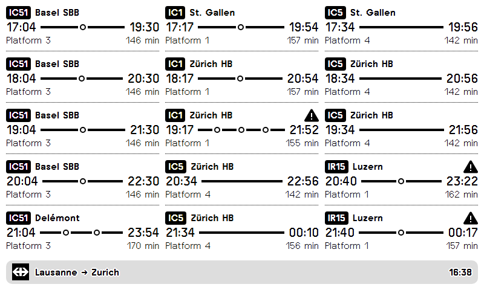

# SBB/CFF Timetable Plugin for TRMNL

A train connection board for [TRMNL](https://trmnl.com) that shows the next Swiss public transport connections between
two stations on your e-ink display.

  

## Overview

This plugin fetches upcoming connections from the [search.ch timetable API](https://search.ch/timetable/api/help) and
lists them with everything you need to decide which train to catch:

- **Line and direction** - the line of the first ride (e.g. IC1) and its terminal station
- **Departure and arrival times** - with live delays and cancellations
- **Changes** - each dot on the line between the two times is a change of train
- **Platform and duration** - departure platform and total travel time in minutes
- **Disruptions** - a warning sign marks connections affected by a disruption
- **Only trains you can catch** - connections leaving before you can reach the station are hidden

All four TRMNL layouts are supported. The number of connections shown adapts to the available space: 15 in full, 6 in
half horizontal, 5 in half vertical and 2 in quadrant.

## How to Use

1. Install via: https://trmnl.com/recipes/32374
2. Configure the plugin:

   | Field                    | Description                                                   | Example  |
   | ------------------------ | ------------------------------------------------------------- | -------- |
   | Departure station        | Station the train departs from                                | Lausanne |
   | Arrival station          | Station the train arrives at                                  | Zurich   |
   | Via station              | Optional station to pass through                              | Olten    |
   | Minutes to reach station | Trains leaving before you can reach the station are not shown | 20       |

3. Add the plugin to a playlist and choose your preferred layout

## Manual Installation

To run your own copy as a private plugin, create a new private plugin on TRMNL with the **Polling** strategy and copy
the files of this repository into it:

| File                                                                               | Where it goes                      |
| ---------------------------------------------------------------------------------- | ---------------------------------- |
| `polling_url.txt`                                                                  | Polling URL                        |
| `settings.yml`                                                                     | Custom fields (form fields)        |
| `transform.js`                                                                     | Pre-processing script (transform)  |
| `shared.liquid`                                                                    | Shared markup                      |
| `full.liquid`, `half_horizontal.liquid`, `half_vertical.liquid`, `quadrant.liquid` | Markup of the corresponding layout |

The raw API response is too large for TRMNL, so `transform.js` reduces it to the few values the templates read.

## Data Source

Timetable data is provided by [search.ch](https://search.ch/timetable/). Trains, trams and buses are included.

This plugin is not affiliated with or endorsed by SBB CFF FFS or search.ch.

## License & Contribution

Released under the [MIT License](LICENSE).

If you find bugs or have improvements, feel free to open an issue or send a pull request.
